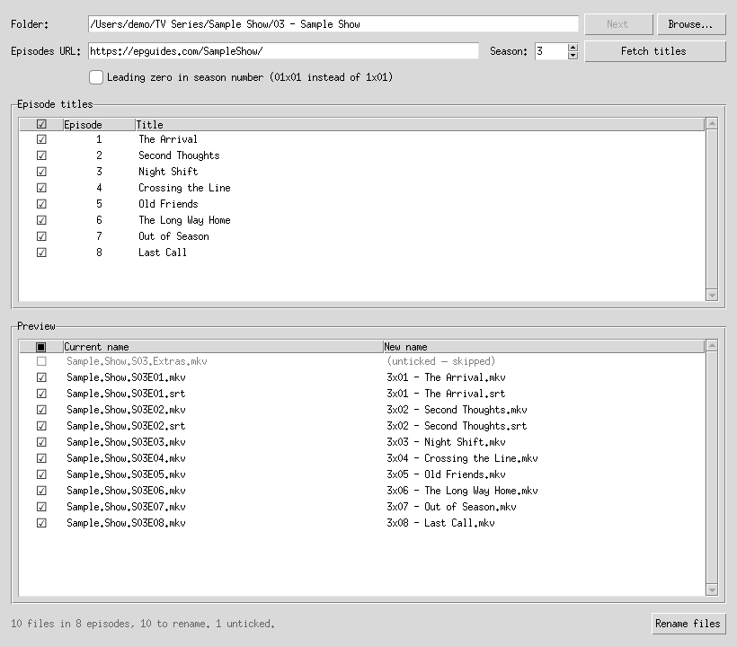

# TV Episode Renamer

A small macOS desktop app that renames the episode files of a TV season using the episode titles from [epguides.com](https://epguides.com).

Point it at a folder, and it works out the show and season, fetches the titles, shows a preview of every old and new file name, and renames the files when you confirm.

```
Sample.Show.S03E01.mkv   →   3x01 - The Arrival.mkv
Sample.Show.S03E01.srt   →   3x01 - The Arrival.srt
Sample.Show.S03E02.mkv   →   3x02 - Second Thoughts.mkv
```



*Version 1.39, shown with sample data. The screenshot was rendered on Linux; on a Mac the app uses the native look.*

## Features

**Fetching titles**
- Paste or browse to a season folder and the app guesses the show from the folder path (the folder above the season folder, in Pascal case, without a leading "The" or "A") and builds the epguides URL, for example `.../Sample Show/03 - Sample Show` becomes `https://epguides.com/SampleShow/`. If that doesn't work, nothing happens and you can enter the URL yourself.
- The season number is pre-filled from the folder name ("Season 3", "S03", "03 - Sample Show", and so on), or 1 if none is found.
- Running times such as `(90 mins)` are stripped from the titles.
- A **Next** button jumps to the next season's folder (it is greyed out when that folder doesn't exist).

**Choosing what gets renamed**
- Every fetched title has a checkbox. An unticked title is left out, and the remaining files are matched to the remaining titles in order. The box in the column header ticks or unticks all.
- Every file in the preview has its own checkbox too. An unticked file is skipped and doesn't use up a title. The box in that column's header ticks or unticks all files.
- Files that share a name apart from the extension (for example `.mkv` and `.srt`) get the same new name.
- Rows that don't need renaming are greyed out.

**Preview and renaming**
- Files are matched in natural alphabetical order and keep their extension.
- New names look like `3x01 - Title.ext`. The episode number always has two digits. A checkbox adds a leading zero to the season (`03x01`).
- The preview refreshes by itself whenever the folder, the titles, the checkboxes or the leading-zero option change.
- The rename asks for confirmation, then runs in the background and updates each row as its file is renamed. If anything fails, every change is rolled back.
- Characters that can't go in a Mac file name are cleaned up (`:` becomes ` - `, `/` becomes `-`).

## Requirements

- macOS
- Python 3 with Tkinter (the installer from [python.org](https://www.python.org/downloads/) includes it)
- An internet connection to fetch titles

No other packages are needed.

## Running it

```
python3 episode_renamer.py
```

`build_app.command` is an optional script that builds a standalone `.app` with PyInstaller.

Before the first run, make it executable. In Terminal, from the repository folder:

```
chmod +x build_app.command
```

After that you can double-click it in Finder (it opens in Terminal) or run `./build_app.command`.

## Notes

- The app reads show data from epguides.com. If a show's page is laid out differently, the fetch can come back empty.
- Renaming files can't be undone from the app, so check the preview first.
